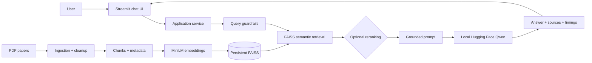

# AI/ML Research Paper RAG Assistant

A portfolio-ready Retrieval-Augmented Generation (RAG) application that answers questions over local AI/ML research papers with paper/page evidence and visible retrieved context.

## Architecture



The Streamlit UI calls the existing `ResearchPaperRAG` orchestration class directly. FastAPI is deliberately excluded: this is a single-user prototype, and another HTTP layer would add maintenance without improving its request path.

## Features

- Multi-PDF ingestion with paper, page, path, and chunk metadata.
- `sentence-transformers/all-MiniLM-L6-v2` embeddings and local persistent FAISS search.
- Grounded prompts, relevance thresholds, safe insufficient-evidence fallbacks, and prompt-injection-aware context handling.
- Guardrails for blank/oversized questions, missing indexes, unreadable PDFs, and model failures.
- Product-style Streamlit interface with answer-depth control, source cards, evidence-strength labeling, exportable Markdown, retrieval transparency, health status, and collapsed performance/debug panels.
- Separate retrieval, reranking, generation, and total-latency logging.
- Local Hugging Face generation by default; no OpenAI key is required.
- Docker, health check, Render Blueprint, and mocked regression tests.

## UI preview

The interface is designed for a portfolio demo rather than a generic PDF-chatbot layout:

- Intentional empty state with corpus-relevant example questions.
- Concise, Standard, and Detailed answer modes that alter the model instruction rather than slicing generated output.
- Markdown answers, clean source cards, and an optional **Why this answer?** evidence panel.
- Retrieval-derived evidence-strength indicator, plus transparent per-stage performance details.
- Professional unsupported-question guidance that does not fabricate an answer.

## Example interaction

**Query:** `What is self-attention?`

**Grounded answer:** Self-attention computes relationships among positions in the same sequence so each position can incorporate information from the other relevant positions. In the Transformer encoder, queries, keys, and values come from the same preceding representation, enabling highly parallel sequence processing.

**Evidence:** *Attention is all you need*, pages 2, 5, and 6.

## Technology choices

| Concern | Choice | Reason |
| --- | --- | --- |
| Embeddings | MiniLM-L6-v2 | Compact and fast semantic embeddings for local use. |
| Vector store | FAISS | Efficient local similarity search with simple persistence. |
| Generator | Qwen2.5-1.5B-Instruct | Stronger free instruction-tuned model running locally in FP16 on the NVIDIA GPU. |
| UI | Streamlit | Clear, maintainable RAG demo interface. |
| Deployment | Docker | Reproducible dependency and runtime packaging. |

## Repository layout

```text
app.py                       Streamlit application
main.py                      Interactive terminal client
src/                         RAG backend and UI service boundary
scripts/build_index.py       Build persistent FAISS index
scripts/evaluate.py          Evaluate retrieval/answer expectations
data/papers/                 Add PDFs here (ignored by Git)
storage/vectorstore/         Generated index (ignored by Git)
tests/                       Mocked regression and UI/service tests
docs/interview_notes.md      Project-specific interview preparation
Dockerfile                   Container build
render.yaml                  Render persistent-disk deployment template
```

## Setup

Use Python 3.11+.

```powershell
python -m venv venv
.\venv\Scripts\Activate.ps1
pip install -r requirements.txt
Copy-Item .env.example .env
```

The default provider is `local_huggingface`; leave token fields blank unless you intentionally use hosted Hugging Face inference. This project's current `.env` uses `Qwen/Qwen2.5-1.5B-Instruct` with `LOCAL_DEVICE=0` on an NVIDIA GTX 1650. `MAX_OUTPUT_TOKENS=160` is the locally calibrated complete-answer budget; the prompt asks the model to finish cleanly instead of the application slicing an answer. The first model load downloads weights and fills GPU memory; later questions reuse the cached model. Never commit `.env`.

## Add papers, build, and run

Put PDFs in `data/papers/`, then build the index:

```powershell
python scripts/build_index.py
streamlit run app.py
```

The current five-paper collection builds to 76 pages and 355 chunks. Rebuild after changing papers. Streamlit's sidebar confirms whether papers and the complete index are available before it sends a question.

The terminal client remains available:

```powershell
python main.py
python main.py --debug
```

Example questions:

- `What limitation of recurrent models motivated Transformers?`
- `Explain multi-head attention.`
- `What dataset did the authors use in the DPR paper?`
- `How does dense passage retrieval differ from retrieval-augmented generation?`

## Tests and evaluation

```powershell
python -m pytest -q
python scripts/evaluate.py
```

Tests mock model and vector-store calls, so they do not spend Hugging Face credits or download models. The repeatable three-case smoke benchmark reports expected-source hit rate, expected-keyword coverage, and answer-generation rate. These are transparent smoke checks, not a claim of automated faithfulness scoring.

## Measured local performance

The earlier CPU configuration used about 50 seconds to generate a short answer. After moving to the GTX 1650 and Qwen2.5-1.5B in FP16, one verified two-sentence response used **0.570 s** retrieval, **16.855 s** generation, and **17.424 s** total, with **3.25 GB** peak GPU memory. These are individual observed runs, not benchmark averages. The local model avoids API cost while GPU inference substantially reduces latency.

## Docker

```powershell
docker build -t research-paper-rag .
docker run --rm -p 8501:8501 `
  -v "${PWD}\data\papers:/app/data/papers:ro" `
  -v "${PWD}\storage\vectorstore:/app/storage/vectorstore:ro" `
  -v "${PWD}\.cache\huggingface:/app/.cache/huggingface" `
  research-paper-rag
```

Open `http://localhost:8501`. The container health check calls Streamlit's `/_stcore/health`. PDFs and indexes are excluded from the image because they are user-provided research assets; mount them or provision persistent storage.

## Deployment recommendation: Render

`render.yaml` defines a Docker web service with a persistent disk and keeps papers, index, and Hugging Face cache under `/app/storage`. It uses `2c-4g`, because local inference plus embeddings is not a realistic fit for a 512 MB free service.

A real deployment requires your Render and Git credentials plus a paid Render service: free Render web services cannot attach persistent disks and lose local files on spin-down. Upload PDFs to `/app/storage/papers`, run `python scripts/build_index.py` on the service to create `/app/storage/vectorstore`, then verify the sidebar says **Index ready**. Render checks `/` before marking the Streamlit web service live.

No live URL is claimed because no Render account authorization was provided. See the [Render Blueprint reference](https://render.com/docs/blueprint-spec), [persistent-disk guide](https://render.com/docs/disks), and [free-plan limits](https://render.com/docs/free).

## Screenshots

Use [docs/screenshots](docs/screenshots/README.md) before publishing. Capture the ready sidebar, a grounded answer with page citations, expanded retrieved context, and debug timing metrics. Do not expose tokens, private paths, or private paper content.

## Limitations and next steps

- Extraction quality depends on the original PDFs; scanned files may need OCR.
- The local model is constrained by the GTX 1650's 4 GB VRAM; substantially larger models require quantization or a stronger GPU.
- Retrieval thresholds and chunking need calibration as the corpus changes.
- Page citations are retrieval evidence, not formal academic citations.
- These controls mitigate hallucinations and prompt injection; they do not eliminate either risk.

Next: hybrid BM25+dense retrieval, metadata filters, stronger reranking, answer-evaluation data, feedback logging, and authentication for shared use.

## Resume-ready summary

**AI/ML Research Paper RAG Assistant** - Built a grounded multi-document research assistant using LangChain, MiniLM embeddings, FAISS, and local Hugging Face Qwen; shipped a Streamlit evidence UI, guardrails, latency instrumentation, tests, and Docker/Render deployment configuration.

- Designed a PDF-to-FAISS pipeline with page-level metadata and deduplicated citations.
- Added grounded prompting, relevance thresholds, validation, and safe fallbacks to reduce unsupported answers.
- Built a Streamlit interface showing sources, raw evidence, index health, and per-stage latency.
- Packaged the system with Docker and documented persistent-volume cloud deployment.
